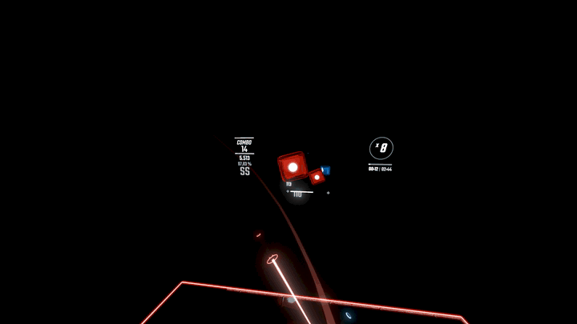

# BeatSaberReplayAI

Generate head and hand motion from a Beat Saber map. The preview below shows a generated replay in Umbranox's ChroViewer.



Recorded replays are resampled to 60 Hz and converted into motion and map features. A GRU encodes the previous half second of motion, a bidirectional GRU encodes upcoming notes, and attention supplies map context to a decoder GRU. It predicts the next half second, feeds that motion back as history, and exports an unscored BSOR replay.

## Run

Use Python 3.10 or newer. From this folder:

```powershell
python -m venv .venv
.venv\Scripts\Activate.ps1
python -m pip install -r requirements.txt
```

The pretrained model, matching statistics, and starting pose are included in `checkpoints/pretrained/` as `model.pth`, `stats.json`, and `idle_seed.npy`. Supply your own map folder to generate a replay.

```powershell
python inference.py --map "data/maps/example" --difficulty "ExpertPlusStandard.dat" --output "outputs/example.bsor" --height 1.65 --random-seed 0
```

`--difficulty` is the map's difficulty filename. The default game-height setting is 1.65 m. CUDA is used when available; use `--device cpu` to run on CPU. Generation includes position noise; `--random-seed` makes it repeatable on the same runtime and device. Use `--checkpoint`, `--stats`, and `--seed` for other model-file locations.

## Train

Supply your own replays and maps:

```powershell
python create_index.py --replays "data/replays" --maps "data/maps" --output "data/index.json"
python preprocess.py --index "data/index.json" --output "data/preprocessed"
python merge_data.py --input "data/preprocessed" --output "data/merged"
python train.py --data "data/merged" --output "checkpoints/training"
python extract_seed.py "data/preprocessed/rep_0.npz" --output "checkpoints/training/idle_seed.npy"
```

Multiple index files can be supplied by repeating `--index`.

`best.pth` has the lowest validation loss. Numbered checkpoints are saved on improvements and every five epochs. Resume with `--resume checkpoints/training/ep50.pth`, keeping the same epoch budget. Use the matching merged statistics and extracted seed for inference with a newly trained model.

Validation holds out the final 5% of merged windows, resamples them each epoch, and uses normalization from the whole dataset. Nearby windows can overlap, so this is a training diagnostic rather than an unseen-map benchmark. Retraining will not reproduce the supplied checkpoint exactly.

Motion quality varies with maps and height settings. It supports ordinary v2/v3 maps and exports motion without hit simulation or scoring.

Replay reading and writing uses [py-bsor](https://github.com/Schippi/py-bsor) by Schippi, under the MIT license. This project's code is also MIT licensed.
